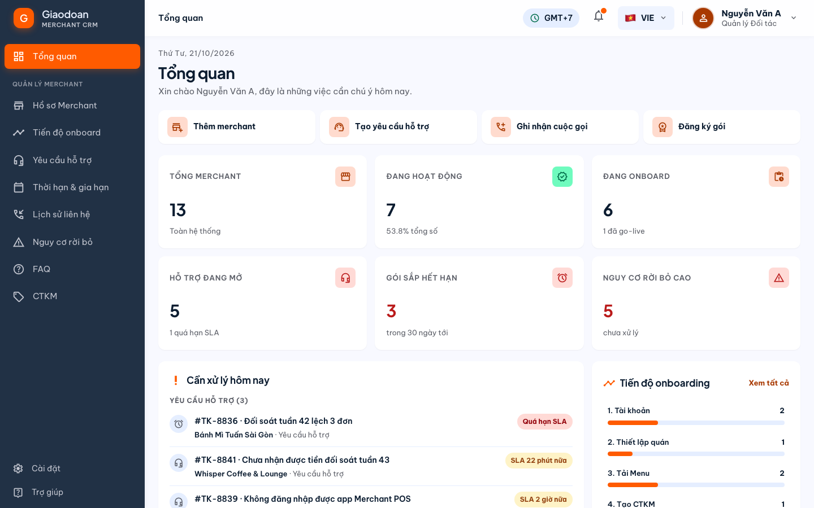
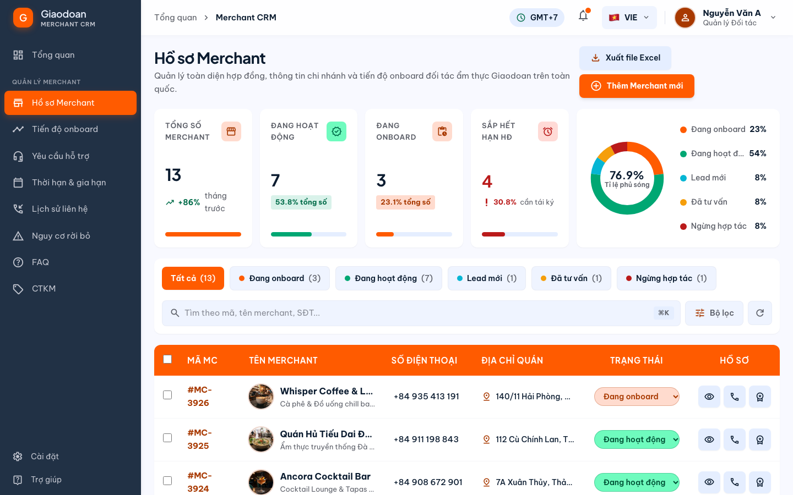
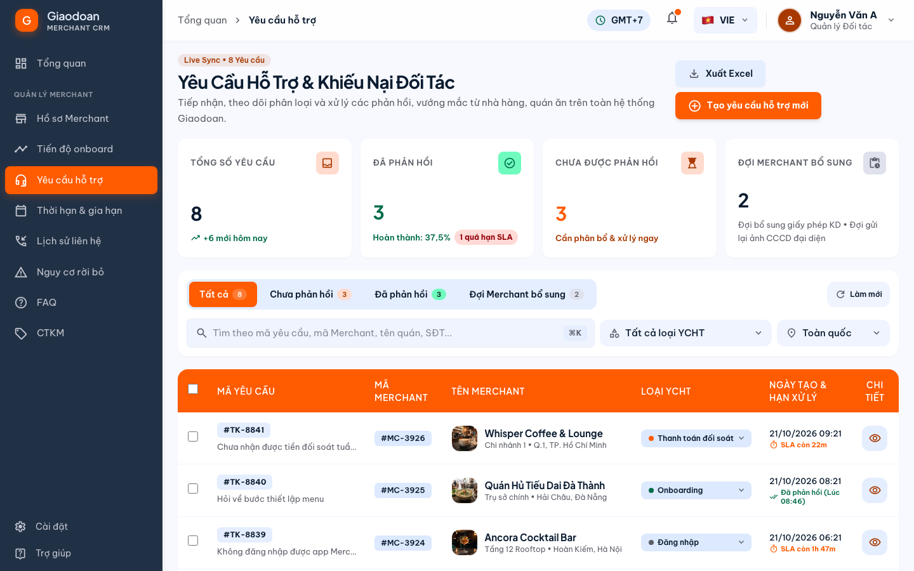
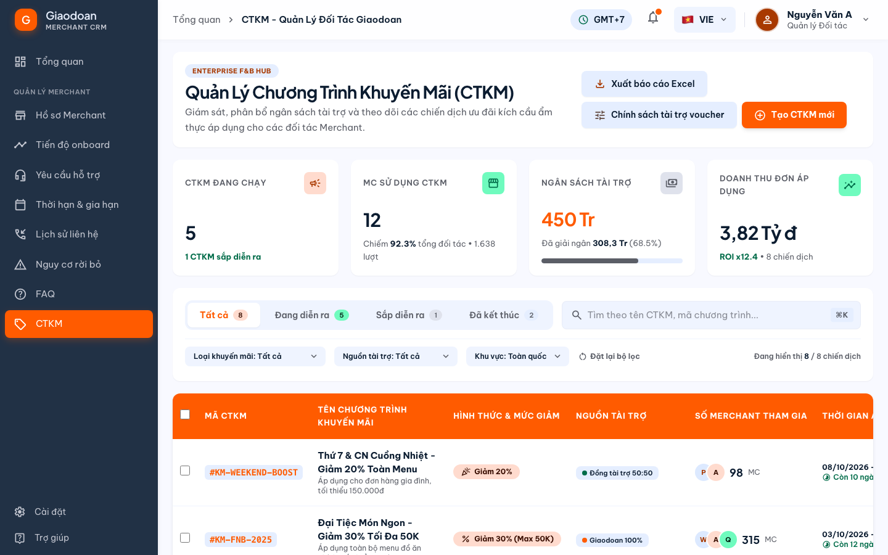
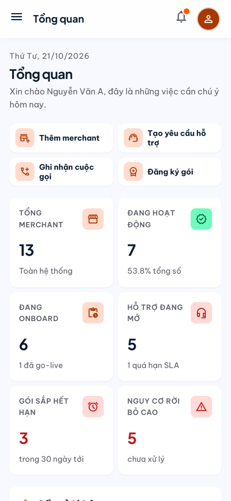
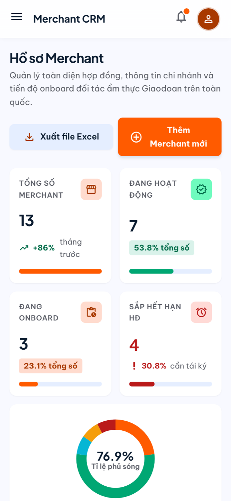
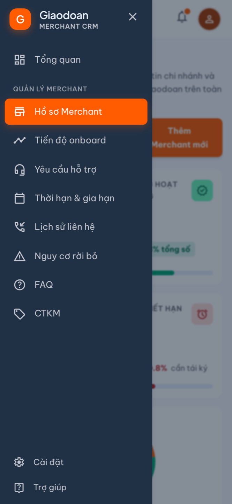

<div align="center">

# 🧡 Giaodoan Merchant CRM

**Hệ thống quản lý đối tác (Merchant) ngành F&B cho Giaodoan**: hồ sơ quán, tiến độ onboarding, yêu cầu hỗ trợ, gói dịch vụ & gia hạn, lịch sử liên hệ, nguy cơ rời bỏ, FAQ và chương trình khuyến mãi. Tất cả gói gọn trong một ứng dụng web chạy mượt trên cả **máy tính** lẫn **điện thoại**.

[](https://giaodoan-crm.giaodoan-merchant-crm.workers.dev)


</div>

---

## 🔗 Liên kết công khai

| | Liên kết |
|---|---|
| 🌐 **Ứng dụng (bản chạy thật)** | https://giaodoan-crm.giaodoan-merchant-crm.workers.dev |
| 📊 Tổng quan (Dashboard) | https://giaodoan-crm.giaodoan-merchant-crm.workers.dev/ |
| 🏪 Hồ sơ Merchant | https://giaodoan-crm.giaodoan-merchant-crm.workers.dev/merchants |
| 📈 Tiến độ onboard | https://giaodoan-crm.giaodoan-merchant-crm.workers.dev/onboarding |
| 🎧 Yêu cầu hỗ trợ | https://giaodoan-crm.giaodoan-merchant-crm.workers.dev/support |
| 📅 Thời hạn & gia hạn | https://giaodoan-crm.giaodoan-merchant-crm.workers.dev/subscriptions |
| 📞 Lịch sử liên hệ | https://giaodoan-crm.giaodoan-merchant-crm.workers.dev/contacts |
| ⚠️ Nguy cơ rời bỏ | https://giaodoan-crm.giaodoan-merchant-crm.workers.dev/churn |
| ❓ FAQ | https://giaodoan-crm.giaodoan-merchant-crm.workers.dev/faq |
| 🏷️ CTKM | https://giaodoan-crm.giaodoan-merchant-crm.workers.dev/promotions |
| ⚙️ Cài đặt | https://giaodoan-crm.giaodoan-merchant-crm.workers.dev/settings |
| 💡 Trợ giúp | https://giaodoan-crm.giaodoan-merchant-crm.workers.dev/help |
| 💻 Mã nguồn | https://github.com/ngocmy180705-coder/Nnm-giaodoan-crm |

> 💡 Không cần đăng nhập, mở link là dùng được ngay. Dữ liệu mẫu đã có sẵn (Whisper Coffee & Lounge, Ancora Cocktail Bar, Phở Bát Đàn…).

---

## 📸 Hình ảnh

### Trên máy tính

| Tổng quan | Hồ sơ Merchant |
|---|---|
|  |  |
| **Yêu cầu hỗ trợ** | **Chương trình khuyến mãi** |
|  |  |

### Trên điện thoại

| Tổng quan | Danh sách Merchant | Menu |
|---|---|---|
|  |  |  |

---

## ✨ Tính năng chính

- 📊 **Tổng quan**: số liệu trực tiếp từ toàn hệ thống, danh sách *"Cần xử lý hôm nay"* (ticket sắp quá hạn SLA, hợp đồng sắp hết hạn, khách cần gọi lại, quán có nguy cơ rời bỏ), tiến độ onboarding, hoạt động gần đây và nút thao tác nhanh.
- 🏪 **Hồ sơ Merchant**: tìm kiếm, lọc theo trạng thái, đổi trạng thái ngay trên danh sách, thêm/sửa hồ sơ. Trang chi tiết là "trung tâm" liên kết tới onboarding, ticket, gói dịch vụ, hóa đơn, lịch sử liên hệ và cảnh báo rời bỏ của quán.
- 📈 **Tiến độ onboarding**: 5 bước (Tài khoản → Thiết lập quán → Tải Menu → Tạo CTKM → Hoàn thành), đánh dấu từng bước và việc con.
- 🎧 **Yêu cầu hỗ trợ**: tạo ticket, theo dõi SLA, phản hồi bằng mẫu soạn sẵn, đổi mức ưu tiên / người phụ trách / trạng thái.
- 📅 **Gói dịch vụ & gia hạn**: gói Bạc / Vàng / Kim Cương, gia hạn tạo hợp đồng + hóa đơn mới, **in hóa đơn khổ A4** (hoặc lưu PDF).
- 📞 **Lịch sử liên hệ**: ghi nhận cuộc gọi, Zalo, gặp mặt; lọc theo nhân viên, kênh, mục đích; danh sách cần gọi lại hôm nay.
- ⚠️ **Nguy cơ rời bỏ**: theo dõi tín hiệu rủi ro, giao nhân sự chăm sóc, tạo chiến dịch chăm sóc hàng loạt.
- ❓ **FAQ** và 🏷️ **CTKM**: thêm, sửa, xóa, ẩn/hiện, ngân sách tài trợ, bảng xếp hạng đối tác.
- 📤 **Xuất Excel (CSV)** ở mọi danh sách, hiển thị đúng tiếng Việt.
- 📱 **Giao diện responsive**: menu trượt trên điện thoại, bảng tự chuyển thành thẻ, form mở toàn màn hình.

> ℹ️ Các nút **"Ghi nhận nhắc Zalo/SMS"** chỉ *ghi lại* lượt nhắc với trạng thái **Chờ gửi**; ứng dụng chưa tự gửi tin. Với từng quán, nút sẽ mở sẵn Zalo / SMS để bạn gửi thủ công.

---

## 🛠️ Công nghệ

| Phần | Công nghệ |
|---|---|
| Giao diện | React 19, TypeScript, Vite, Tailwind CSS (thiết kế gốc từ Google Stitch) |
| Dữ liệu | Supabase (PostgreSQL + REST API) |
| Hosting | Cloudflare Workers (static assets), gói **miễn phí** |

---

## 🚀 Chạy trên máy

Yêu cầu: **Node.js 20+** và **pnpm**.

```bash
# 1. Cài thư viện
pnpm install

# 2. Tạo file cấu hình
cp .env.example .env.local
# rồi điền:
#   VITE_SUPABASE_URL=https://<project>.supabase.co
#   VITE_SUPABASE_ANON_KEY=<publishable key>

# 3. Chạy
pnpm dev        # mở http://localhost:5173
```

Các lệnh khác:

| Lệnh | Tác dụng |
|---|---|
| `pnpm build` | Kiểm tra TypeScript và build ra thư mục `dist/` |
| `node scripts/check-db.mjs` | Kiểm tra kết nối Supabase và đếm dữ liệu từng bảng |
| `npx wrangler deploy` | Build xong thì đưa lên Cloudflare |

### Tạo cơ sở dữ liệu mới

```bash
npx supabase link --project-ref <project-ref>
npx supabase db push --include-seed   # tạo bảng + nạp dữ liệu mẫu
```

Cấu trúc bảng nằm trong `supabase/migrations/`, dữ liệu mẫu trong `supabase/seed.sql`.

---

## 📁 Cấu trúc thư mục

```
├── src/
│   ├── pages/          # Mỗi màn hình một file (Tổng quan, Merchant, Onboarding…)
│   ├── components/     # Layout, Modal, bảng responsive, chuông thông báo…
│   └── lib/            # Kết nối Supabase, định dạng ngày/tiền, đường dẫn, cài đặt
├── supabase/
│   ├── migrations/     # Cấu trúc cơ sở dữ liệu
│   └── seed.sql        # Dữ liệu mẫu
├── design/             # Thiết kế gốc (HTML từ Google Stitch)
├── docs/
│   ├── DATA_MODEL.md   # Mô tả các bảng dữ liệu
│   ├── UI_GUIDE.md     # Quy ước giao diện & responsive
│   └── screenshots/    # Ảnh minh họa
└── wrangler.jsonc      # Cấu hình Cloudflare
```

---

## ⚠️ Lưu ý quan trọng

- 🔓 **Cơ sở dữ liệu đang để công khai** (không cần đăng nhập): ai có link đều có thể xem, sửa, xóa dữ liệu. Phù hợp để demo; **cần thêm đăng nhập trước khi nhập dữ liệu thật** của đối tác.
- 💤 **Supabase gói miễn phí sẽ tạm dừng nếu khoảng 1 tuần không có ai dùng.** Nếu web mở được nhưng không hiện dữ liệu, hãy vào Supabase Dashboard và bấm *Restore project*.
- 💾 Gói miễn phí **không có sao lưu tự động**.

---

<div align="center">

Made with 🧡 by **ngocmy180705-coder**

</div>
